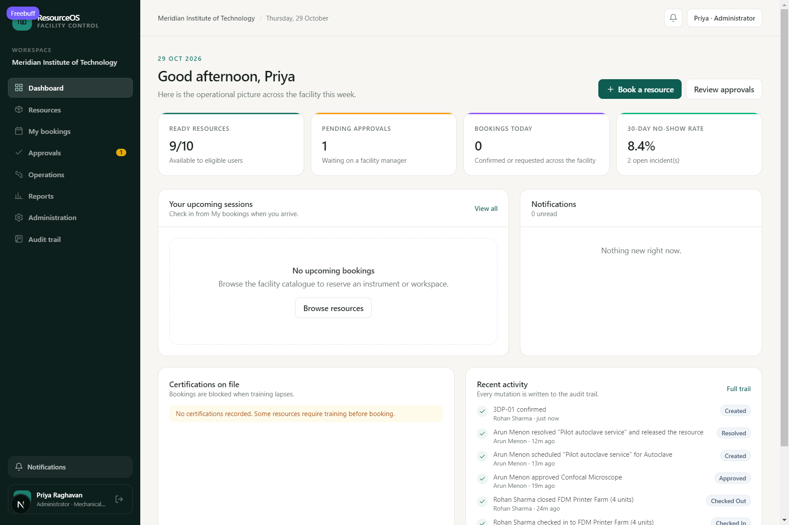

# ResourceOS

An open-source, self-hostable **facility booking control loop** for shared labs, workshops and equipment pools. ResourceOS handles the whole operational chain — eligibility and training, approval, conflict-free reservation, check-in/check-out, maintenance blackouts, incidents, audit trail and utilization reporting — as one deterministic, auditable application.

The pitch, business model and demo script are in [docs/pitch.md](docs/pitch.md). The 16-slide deck is [docs/ResourceOS-CodeHack-2026.pptx](docs/ResourceOS-CodeHack-2026.pptx), generated from [scripts/make-deck.mjs](scripts/make-deck.mjs).

Built for the "free / open-source build plan": no ML in v1, no microservices, no Kubernetes, no paid APIs.



---

## What works

- **Tenant-scoped accounts** — scrypt password hashing, httpOnly session cookies, role-based access (administrator, facility manager, technician, member).
- **Resource catalogue** — categories, specs, locations, capacity, per-resource opening hours, max slot length, approval requirement and required training.
- **Eligibility checks on every request** — membership, resource status, opening hours, training validity, per-user active-booking quota, booking horizon, maintenance blackout.
- **Database-enforced conflict prevention** — `EXCLUDE USING gist (resource_id WITH =, tstzrange(starts_at, ends_at) WITH &&)` on active bookings. Two concurrent submits cannot both win, regardless of application logic.
- **Approvals** — managers approve or reject with a note; rejection feeds the unmet-demand report.
- **Check-in / check-out** — check-in opens 30 minutes before the slot; checkout records condition and consumables in a usage session.
- **Maintenance** — scheduling creates a blackout, warns about overlapping bookings and requires an explicit override; resolving releases the resource.
- **Incidents** — any member can report with severity; managers record the resolution and optionally release the resource.
- **Reports** — downtime-adjusted utilization, actual usage, no-show rate, unmet demand by cause, weekly volume, most active users, incident summary. CSV export for utilization, bookings, unmet demand and audit.
- **Audit trail** — events with actor, entity and metadata; a database trigger rejects `UPDATE` and `DELETE`, so an override can be recorded but never quietly rewritten.
- **Background job** — no-show detection after the grace period and automatic closure of overdue sessions (`db/jobs.mjs`).
- **Row-level security** — every tenant table has an RLS policy keyed on `app.current_organization_id`; the app connects as a non-superuser role, so even a query missing its `organization_id` filter returns nothing.
- **CSV resource import** and member invitations with roles and departments.
- **Integration foundation** — tenant-scoped connections to external booking, lab-management, finance and maintenance systems, with idempotent ingestion, external-ID mappings, source provenance, sync checkpoints, retries, failed-record quarantine and AES-256-GCM sealed provider credentials. See [docs/integrations.md](docs/integrations.md). No vendor connector is implemented yet.
- **Capital decisions** — equipment evidence (utilisation, downtime, unmet demand, repair spend, lifecycle cost) turned into an assessment of five options (buy, repair, share, reallocate, retire), with the arithmetic and the missing data shown, and a persistent decision record that only an authorised person can decide. See [docs/capital-decisions.md](docs/capital-decisions.md).

- **Operational readiness** — calibration, safety holds, maintenance windows and required stock are evaluated as one verdict (`ready` / `warnings` / `blocked`) and enforced on the server at booking creation, approval and check-in. Consumables hold transactional stock with an audited movement ledger. See [docs/readiness.md](docs/readiness.md).
- **Work orders and verified release** — an incident converts into a numbered work order with an owner, diagnosis, parts, labour, costs and downtime; the repair is signed off, independently verified where policy requires it, and only an authorised release clears the separate resource hold after re-running every readiness check. A **controlled emergency override** records scope, a mandatory reason, expiry, affected bookings and an append-only audit trail, and cannot bypass calibration, safety holds, retirement, quota or training. See [docs/work-orders.md](docs/work-orders.md).

### Demo tenant

Seeds *Meridian Institute of Technology* with 10 instruments, 8 members, 90 days of booking history, maintenance, incidents, unmet demand and notifications.

| Role | Email | Password |
|---|---|---|
| Administrator | `priya@meridian.edu` | `demo1234` |
| Facility manager | `arun@meridian.edu` | `demo1234` |
| Technician | `kavya@meridian.edu` | `demo1234` |
| Member | `rohan@meridian.edu` | `demo1234` |

`db/seed-demo.mjs` builds a **separate** synthetic tenant for the capital-decision
demo (*Northfield Institute of Technology*) in its own disposable database. It
only inserts, refuses to run unless the database name ends in `_demo`/`_test` and
`DEMO_SEED_CONFIRM=yes` is set, and refuses to run twice. Its accounts
(`nandita.rao@northfield.demo` administrator, `ishaan.mehta@northfield.demo`
facility manager, password `demo1234`) are the ones to use against that database;
the Meridian buttons on the sign-in page belong to `npm run db:seed`.

```bash
createdb resourceos_demo
# apply schema + migrations to it, then:
DEMO_DATABASE_URL=postgres://.../resourceos_demo DEMO_SEED_CONFIRM=yes npm run db:seed-demo
```

Full instructions and the dataset description: [docs/capital-decisions.md](docs/capital-decisions.md#data-synthetic-demo-tenant).

---

## Stack

| Layer | Choice |
|---|---|
| App | Next.js 16 (App Router, Server Actions), TypeScript, React 19 |
| Styling | Tailwind CSS v4 |
| Database | PostgreSQL 16+ (`btree_gist`, `pgcrypto`) |
| Data access | `pg` + hand-written SQL and SQL migrations |
| Auth | scrypt + opaque session tokens (hashed at rest) |
| Jobs | Cron-invoked Node script (no broker needed at this scale) |
| Deployment | Docker / Docker Compose behind Caddy or Nginx |

Deliberate choices: a separate API process (Fastify) and Redis/BullMQ are unnecessary for a single-tenant-per-request CRUD workload of this size. One deployable app, one database and one cron process keep operations small. Object storage (MinIO) and email delivery are not wired in yet — see [Not built yet](#not-built-yet).

---

## Quick start (local)

Requirements: Node 24+, PostgreSQL 16+.

```bash
npm install

# 1. Create the database and a NON-superuser application role.
#    RLS only applies to non-superusers, so do not skip this.
psql -U postgres -c "CREATE ROLE resourceos_app LOGIN PASSWORD 'app_dev_password';"
psql -U postgres -c "CREATE DATABASE resourceos OWNER postgres;"
psql -U postgres -d resourceos -c "GRANT USAGE ON SCHEMA public TO resourceos_app;"

# 2. Configure connections (see .env.example).
cp .env.example .env.local

# 3. Apply schema, grant table privileges, load demo data.
npm run db:migrate
npm run db:seed

# 4. Run.
npm run dev
```

`db/init.sql` performs the role creation and grants automatically for the Docker path. For a manual setup, after `db:migrate` run:

```sql
GRANT SELECT, INSERT, UPDATE, DELETE ON ALL TABLES IN SCHEMA public TO resourceos_app;
```

If you have applied the schema before and need a clean demo:

```bash
npm run db:reset   # DESTRUCTIVE: drops the public schema
npm run db:seed
```

### Docker Compose

```bash
docker compose up -d --build          # db + migrate + app + jobs
docker compose --profile demo up seed # load the demo tenant once
```

The app listens on `http://localhost:3000`. Put Caddy or Nginx in front for TLS, and keep port 3000 bound to localhost if the proxy runs on the same host.

```caddyfile
facilities.example.edu {
  reverse_proxy 127.0.0.1:3000
}
```

---

## Configuration

`.env.local` / environment:

| Variable | Purpose |
|---|---|
| `DATABASE_URL` | Application connection. Must use a **non-superuser** role for RLS to apply. |
| `ADMIN_DATABASE_URL` | Privileged connection used only by `db:migrate.mjs` and `db/seed.mjs`. |
| `APP_URL` | Optional absolute origin for links. |
| `INTEGRATION_ENCRYPTION_KEY` | 32-byte key (`openssl rand -hex 32`) used to seal provider credentials. Required only when using integrations with credentials. |

Secrets are never read from files at runtime except through environment variables. Session cookies are `httpOnly`, `SameSite=Lax`, and `Secure` in production.

---

## Data model

```
organizations ─┬─ departments, facilities
               ├─ memberships ── users ── sessions
               ├─ training_courses ── training_records
               ├─ resources ─┬─ availability_rules
               │             ├─ blackout_periods ── maintenance_records
               │             ├─ bookings ── usage_sessions
               │             └─ incidents
               ├─ unmet_demand_events
               ├─ notifications
               └─ audit_events
```

`capital_decisions` snapshots the evidence, all five alternative assessments, the
assumptions, the system recommendation and the human decision, with a status check
constraint and a trigger that rejects `DELETE`.

Key invariants:

- `bookings.ends_at > bookings.starts_at`.
- Active reservations (`requested`, `confirmed`, `completed`) cannot overlap on a resource — enforced by an exclusion constraint, not a read-then-write check.
- Every tenant-owned row carries `organization_id` and is covered by an RLS policy.
- Statuses are constrained by `CHECK` constraints; no free-text state.
- Audit events are append-only at the database level: `audit_events_no_rewrite` raises on any `UPDATE` or `DELETE`.

---

## Security model

Three layers, each independent:

1. **Session + role authorization** — every server action and route handler re-reads the session. UI hiding is never the control.
2. **Explicit tenant filtering** — all reads/writes run through `withOrg(organizationId, ...)`, which sets `app.current_organization_id` inside a transaction.
3. **PostgreSQL RLS** — policies compare `organization_id` to the session GUC. Verified: the application role sees `0` bookings without a tenant context and all rows with one.

Additional measures: scrypt password hashing with per-user salt and constant-time comparison, sha256-hashed session tokens, single-use login throttling, parameterized SQL everywhere, and no secrets in client bundles.

Known limitation: `memberships` has RLS disabled because login must resolve a user's workspace *before* a tenant is known. All membership queries are filtered by `user_id` or `organization_id` in code. If you enable RLS there, move the login lookup into a `SECURITY DEFINER` function.

---

## API

Server Actions power the UI. JSON/CSV endpoints:

| Endpoint | Method | Purpose |
|---|---|---|
| `/api/resources/{id}/availability?date=YYYY-MM-DD` | GET | 30-minute slot states (free / booked / blackout / past) |
| `/api/reports/utilization?from=&to=` | GET | CSV utilization report |
| `/api/reports/bookings?from=&to=` | GET | CSV booking ledger |
| `/api/reports/unmet-demand?from=&to=` | GET | CSV unmet demand |
| `/api/reports/audit` | GET | CSV audit trail |

All endpoints require a session; report endpoints require staff. Responses are `private, no-store`.

---

## Integrations

`/integrations` (administrators and facility managers) connects a workspace to an
external system and imports resources or bookings. The full contract, sync
semantics and provider-registration steps are in [docs/integrations.md](docs/integrations.md).

| Piece | Where |
|---|---|
| Connector interface + types | `lib/integrations/types.ts` |
| Connector registry | `lib/integrations/registry.ts` |
| Sync engine (idempotency, quarantine, checkpoints, retries, audit) | `lib/integrations/engine.ts` |
| Credential sealing (AES-256-GCM) | `lib/integrations/crypto.ts` |
| Schema | `db/migrations/0001_integrations.sql` |

Guarantees: one external record maps to at most one local row
(`integration_entity_map`), imported rows carry provenance back to their
connection, records that fail validation or collide are quarantined instead of
failing the run, a revoked connection cannot start a sync, and every integration
table is behind the same tenant RLS policy. Cross-institution sharing is not
implemented.

---

## Background job

```bash
npm run jobs
```

Marks confirmed bookings as `no_show` once `starts_at + grace` has passed without a check-in (freeing the slot), and closes overdue usage sessions at their scheduled end. Run every five minutes from cron or the `jobs` service in Compose:

```cron
*/5 * * * * cd /srv/resourceos && node --env-file=.env.local db/jobs.mjs >> /var/log/resourceos-jobs.log 2>&1
```

---

## Tests

```bash
npm test
```

`tests/tenancy.test.mjs` builds a throwaway `resourceos_test` database from `db/schema.sql`, connects as the non-superuser application role, and asserts the guarantees the product relies on:

| Test | Asserts |
|---|---|
| No tenant context | The application role reads zero tenant rows |
| Tenant context | Unfiltered reads return only the active organization; foreign IDs look absent |
| Cross-tenant write | An insert for another organization fails with `42501` and stores nothing |
| Concurrent overlap | 8 simultaneous requests for one window: exactly one wins, the rest abort (`23P01`/`40P01`) |
| Adjacent window | Back-to-back slots on the same resource are allowed |
| Idempotency | A repeated submission key cannot create a second booking (`23505`) |
| Append-only audit | `UPDATE` and `DELETE` on `audit_events` are rejected |

`tests/integrations.test.mjs` builds a second throwaway database
(`resourceos_int_test`) from the baseline schema **plus** `db/migrations`, then
drives the real sync engine through the connector contract:

| Test | Asserts |
|---|---|
| Replayed feed | A second sync of the same feed imports nothing new and creates no duplicate rows or mappings |
| Quarantine | Invalid fields are held as `validation`; a code already used locally is held as `conflict`; valid records still import |
| Retry after correction | A re-sync closes the quarantine rows, imports the fixed records and refreshes the already-imported one |
| Transport failure | A throwing `pull` marks the run failed, writes an audit event, corrupts nothing, and succeeds on retry |
| Revoked connection | A new sync is rejected with `connection_revoked` and opens no run row |
| Cross-tenant inspection | Another institution's connection, sealed credentials, mappings, sync history and quarantine are invisible; a cross-tenant insert fails with `42501` |
| Tenant mixing | A sync for one tenant adds no rows to another |
| Pooled context | `set_config(..., true)` leaves no tenant behind on a reused client |
| Credential sealing | Round-trip works, ciphertext does not embed the plaintext, tampering and a wrong key are rejected |

`tests/integration-actions.test.mjs` covers server-action authorization
(member/manager/administrator, foreign tenant, no credential leakage) and
`tests/capital.test.mjs` covers the capital workflow:

| Test | Asserts |
|---|---|
| Utilisation | Computed from usage hours over available hours, not stored |
| Downtime | Reduces available hours instead of inflating utilisation |
| Missing data | Absent cost, life and condition are reported, never assumed as zero |
| Share / reallocate | An under-used asset wanted by other departments is recommended for sharing |
| Buy new | An asset past its life with heavy use, downtime and repair burden outranks repair |
| Retire | A poor, barely used asset past its life is recommended for retirement |
| Workflow | Evidence → recommendation → stored pending record → human override → decided record, with audit rows |
| Snapshot | Renaming or re-costing the asset afterwards does not rewrite the saved record |
| Tenant isolation | Another institution cannot read the asset, generate a record, or decide a foreign record |
| Immutability | `DELETE` on a decision record is rejected by the database |

`tests/readiness.test.mjs` (22 tests) covers the operational-readiness slice: the pure evaluator (expired/missing/failed calibration, safety holds, maintenance windows, stock), booking creation refused with a recorded unmet-demand reason, approval re-checked after readiness regresses, check-in blocked by a hold raised post-approval, single-consumption per booking, concurrent stock contention that cannot go negative, role permissions and tenant isolation.

`tests/work-orders.test.mjs` (24 tests) covers the work-order slice: lifecycle transitions, incident conversion and uniqueness, assignment and release permissions, repair completion without automatic hold clearance (including the asset staying unbookable), self-verification refusal, rejected verification and rework, authorised release clearing exactly one hold and resolving the incident, expired calibration still blocking release, escalation, concurrent release attempts, reopen, override authorisation, mandatory reason/expiry, non-overridable conditions, affected-booking records with honest delivery status, append-only override and event history, cross-tenant access and RLS.

Use a dedicated database server or role for this: the suites drop and recreate `resourceos_test`, `resourceos_int_test`, `resourceos_actions_test`, `resourceos_capital_test`, `resourceos_readiness_test` and `resourceos_workorders_test` on every run, and never touch the `resourceos` or `resourceos_demo` databases.

---

## Verification performed

- `npm run build` — production build and TypeScript check pass.
- Seeded 708 bookings across 90 days; reports aggregate them correctly.
- Browser-tested: login/logout, role-based navigation, resource search, booking, quota rejection, training rejection, cancellation, manager approval, check-in, checkout, maintenance conflict + override + resolution, CSV import, reports, audit trail, CSV export.
- Database-tested: overlapping insert is rejected with `23P01`; RLS returns zero rows without a tenant GUC.
- `npm test` — 40 tests pass: 7 tenant-isolation, concurrency and audit-immutability; 10 integration-foundation (idempotency, quarantine, retry, revocation, cross-tenant isolation, pooled tenant context, credential sealing); 5 integration server-action authorization; 5 partial-sync/checkpoint continuation; 13 capital-decision (calculations, tenant isolation, persistence, workflow).
- Browser-verified on the synthetic demo tenant: `/capital` renders live aggregates (12 assets, ₹4.55 Cr recorded value, 26.2% portfolio utilisation, ₹26.5 L maintenance, 1,292 downtime hours); SEM-01 recommends buy-new (0.80) over repair (0.60); generating creates a pending record; recording a human override writes the decision, author, rationale and timestamp; the audit trail shows both events; no console or network errors.
- `npm run jobs` detects a stale confirmed booking and writes a no-show plus usage record.

The suite above covers the database guarantees. The booking state machine (approval, check-in, checkout, no-show transitions) was exercised manually through the browser and not yet covered by automated tests.

---

## Not built yet

Honest gaps against the full plan, deliberately deferred from this slice:

- **Email delivery** — in-app notifications are real; the work-order/override flows also record every outbound email in `notification_outbox` as `unavailable` (or `pending` when a transport is configured), never as sent. Add SMTP (institutional relay, Postal or Mailu) and a worker that drains the outbox.
- **File evidence for incidents** — no object storage yet. MinIO + signed URLs is the intended path; do not store uploads on the app filesystem.
- **Booking reminders** (24h/1h) and approval escalation — the job runner exists; add these as additional job functions with a `notifications` dedupe key.
- **A real vendor connector** — the integration foundation is in place and tested against the reference feed only. A provider integration needs that provider's documented API and a sandbox test before it can be claimed.
- **Capital decisions: procurement link** — replacement cost is a manually entered figure (or a derived estimate, clearly flagged); nothing is fetched from a finance or procurement system, and there is no purchase-order export. Financial figures are evidence for a human, not a valuation.
- **Capital decisions: cross-institution sharing** — the `share` and `reallocate` options are intra-institution only.
- **Scheduled integrations, order/invoice entities, credential rotation UI** — see [docs/integrations.md](docs/integrations.md#known-gaps).
- **Approval delegation, MFA for admins, password reset, member deactivation**.
- **Scheduled report delivery and a Metabase read replica** — CSV export is in place.
- **ML** — intentionally absent. No-show prediction and demand forecasting need months of real tenant data; start with logistic regression or classical time series, never deep learning.

---

## License

MIT for the application code. PostgreSQL, Next.js and the other dependencies retain their own licenses.
